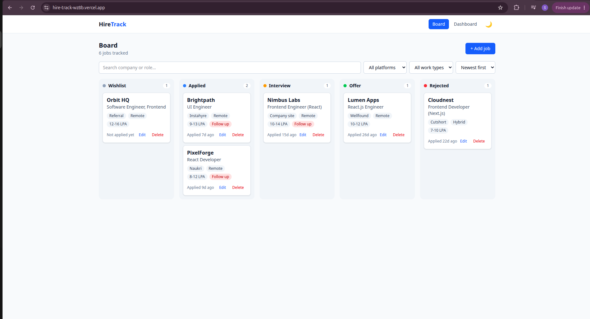
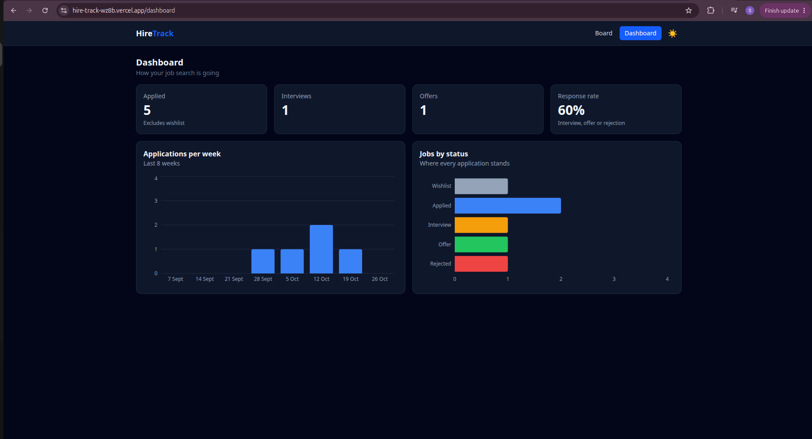

# HireTrack

A job application tracker with a drag-and-drop Kanban board, a stats dashboard and dark mode. I built it to track my own job search.

[](https://github.com/feelfreeongithub/HireTrack/actions/workflows/ci.yml)

**🔗 Live demo:** [hire-track-wz8b.vercel.app](https://hire-track-wz8b.vercel.app/)




## Features

- **Kanban board** with 5 stages: Wishlist → Applied → Interview → Offer → Rejected
- **Drag and drop** between columns with the mouse or keyboard (accessible)
- **Add, edit and delete** jobs with a validated form
- **Search, filter and sort** by company, role, platform, work type and date
- **Job details drawer** with notes and a **"Follow up due"** reminder badge
- **Dashboard** with stats (response rate, interviews, offers) and charts
- **Dark mode** that follows your system and remembers your choice
- Data saved in **localStorage**, with no backend needed
- **Responsive** on mobile, tablet and desktop

## Tech stack

React 19 · Vite · Tailwind CSS v4 · React Router · dnd-kit · Recharts · Vitest · React Testing Library · GitHub Actions · Vercel

## How it works

- **State:** `useReducer` + Context API. Every change (add, edit, move, delete) goes through one reducer.
- **Derived data:** filters and dashboard stats are calculated with `useMemo`, so they're never out of sync.
- **Drag and drop:** cards use `useDraggable`, columns use `useDroppable`. Dropping a card dispatches `MOVE_JOB` with the new status.
- **Accessibility:** keyboard drag-and-drop, labelled form fields and buttons, Escape closes dialogs, visible focus rings.

## Testing and CI/CD

- Unit tests for the reducer and component tests for the filter bar and job form (**Vitest + React Testing Library**)
- **GitHub Actions** runs lint, tests and build on every push and pull request
- **Vercel** deploys automatically when `main` is updated

## Run locally

```bash
git clone https://github.com/feelfreeongithub/HireTrack.git
cd HireTrack
npm install
npm run dev        # start the app
npm run test:run   # run the tests
```

## What I learned

- Managing app state with `useReducer` and Context, and testing the reducer on its own
- Building accessible drag and drop with dnd-kit
- Setting up a CI/CD pipeline with GitHub Actions and Vercel